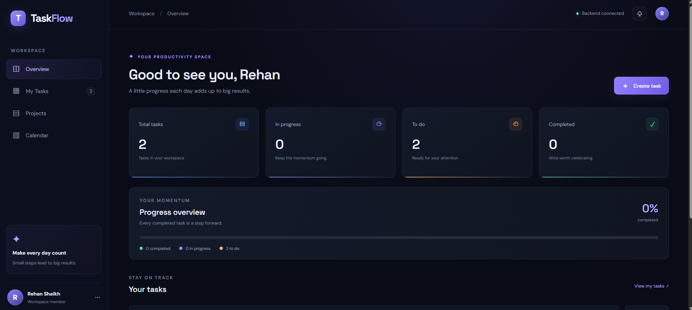

# TaskFlow — Full-Stack Task Management System

A modern task management application built with **React, Spring Boot, and MySQL**. TaskFlow lets users create, view, edit, update, and delete tasks through a dashboard interface.

## Dashboard Preview



## Features

- Create and manage tasks
- Edit task details
- Set task priority and deadlines
- Update task status
- Delete tasks with confirmation
- Persist task data in MySQL
- REST API integration between frontend and backend
- Dashboard with task statistics
- Search and filter tasks

## Technology Stack

| Layer | Technologies |
|---|---|
| Frontend | React, Vite, JavaScript, CSS |
| Backend | Java, Spring Boot, Spring Data JPA |
| Database | MySQL |
| Build Tool | Maven |
| API | REST |

## Project Structure

```text
TaskFlow/
├── frontend/
│   ├── public/
│   └── src/
├── backend/
│   └── src/
├── screenshots/
│   └── dashboard.png
├── database/
├── .gitignore
└── README.md
```

## Prerequisites

Install the following:

- Java JDK
- Maven
- Node.js and npm
- MySQL Server

## Database Configuration

Create the database in MySQL:

```sql
CREATE DATABASE taskflow_db;
```

Configure your local database credentials in:

`backend/src/main/resources/application.properties`

Use `backend/src/main/resources/application-example.properties` as a reference. Replace its password placeholder with your own password in your local configuration only. Never commit real passwords or secrets.

## Run the Backend

Open a terminal:

```powershell
cd backend
mvn spring-boot:run
```

Backend URL: `http://localhost:8080`

## Run the Frontend

Open a second terminal:

```powershell
cd frontend
npm.cmd install
npm.cmd run dev
```

Frontend URL: `http://localhost:5173`

## REST API Endpoints

| Method | Endpoint | Description |
|---|---|---|
| GET | `/api/tasks` | Retrieve all tasks |
| GET | `/api/tasks/{id}` | Retrieve a task by ID |
| POST | `/api/tasks` | Create a task |
| PUT | `/api/tasks/{id}` | Update a task |
| DELETE | `/api/tasks/{id}` | Delete a task |

## Future Improvements

- User authentication and authorization
- Project and team management
- Calendar view
- Task reminders
- Cloud deployment

## Author

**Rehan Iqbal Shaikh**

GitHub: [Rehan-shaikh786](https://github.com/Rehan-shaikh786)

Project Repository: [TaskFlow](https://github.com/Rehan-shaikh786/TaskFlow)
